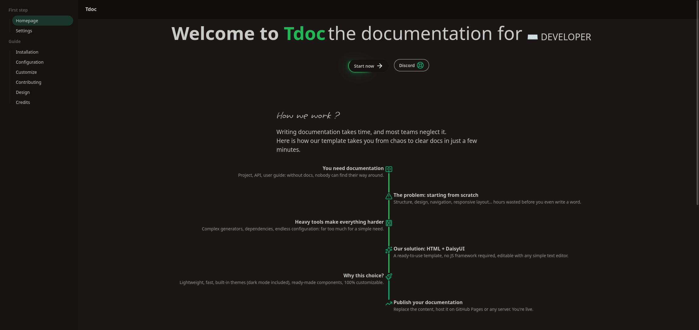

# Tdoc

Tdoc is a template of documentation for any project example (Api, tools, website, ect)

Based on HTML, css (TailwindCSS with daisyui) and JavaScript


## Documentation how to use template:

[documentation](https://tdoc-documentation.netlify.app/)

## Previews




# requirements

1. Git for use ```git clone``` command you can find them at https://git-scm.com/

2. Text editor the best known ```Visual Studio Code``` at https://code.visualstudio.com/

> For windows user make sure you have add git on your path [Tutoriel](https://www.architectryan.com/2018/03/17/add-to-the-path-on-windows-10/).


# Installation

For install Tdoc is very is 

1. Open terminal and type ```git clone https://github.com/PetitGameur404/Tdoc```

2. still in terminal ```cd Tdoc```

3. and ```code .``` (if you use vscode or juste open project with your text editor)

# Customize

Tdoc use Daisyui for themes and components so is very is to change the themes

1. You can find the themes in a html balise in above of your head

2. edit the theme name ```<html data-theme="forest"> <!-- HERE ! ;) -->```

All Daisyui themes : [all native themes](https://daisyui.com/theme-generator/)

> More about Customize Tdoc at https://tdoc-documentation.netlify.app/custom

# Credits

[PetitGameur404](https://lucahallet.com)